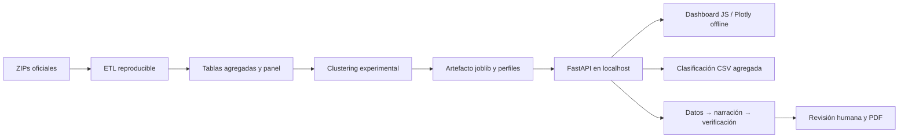

# Decisiones de arquitectura del MVP

## Componentes

La app es un **monolito local sencillo**, no un sistema de múltiples servicios. No se necesita una cola, base de datos de perfiles relacional ni un proveedor LLM para completar el core workflow.

## Interfaces

- Datos del modelo: `datos/processed/producto/{observaciones_dashboard.csv,perfiles.json}`.
- Modelo: `ml/modelos/kmeans5_exploratorio.joblib` generado localmente. **No cargar joblib externos no confiables**.
- Servidor FastAPI: `src/dashboard_api.py`.
- Frontend offline: `dashboard/index.html`, `dashboard/static/{app.css,app.js,plotly.min.js}`.
- Cadena de fichas: `src/education.py`, revisión local SQLite únicamente.
- Construcción de artefactos: `python -m src.prepare_product`, `python -m src.build_delivery`, `python -m src.technical_report`.

## Pruebas realizadas

`python -m pytest -q tests` valida sumas y agrupación, endpoints, filtros, auditoría territorial, inferencia de CSV con esquema completo, rechazo de datos inválidos y PDF. Además se verificó la consistencia de asignaciones entre el modelo entrenado y la API en una muestra aleatoria de 120 observaciones del entrenamiento (100% de concordancia, **no** es una métrica de generalización supervisada).

## Limitaciones de seguridad y operabilidad

No exponer fuera de `127.0.0.1` sin autenticación, autorización, control de cargas, protección CSRF, auditoría multiusuario y política de datos. La aprobación local documenta revisión declarada, no implementa firma digital certificada.
